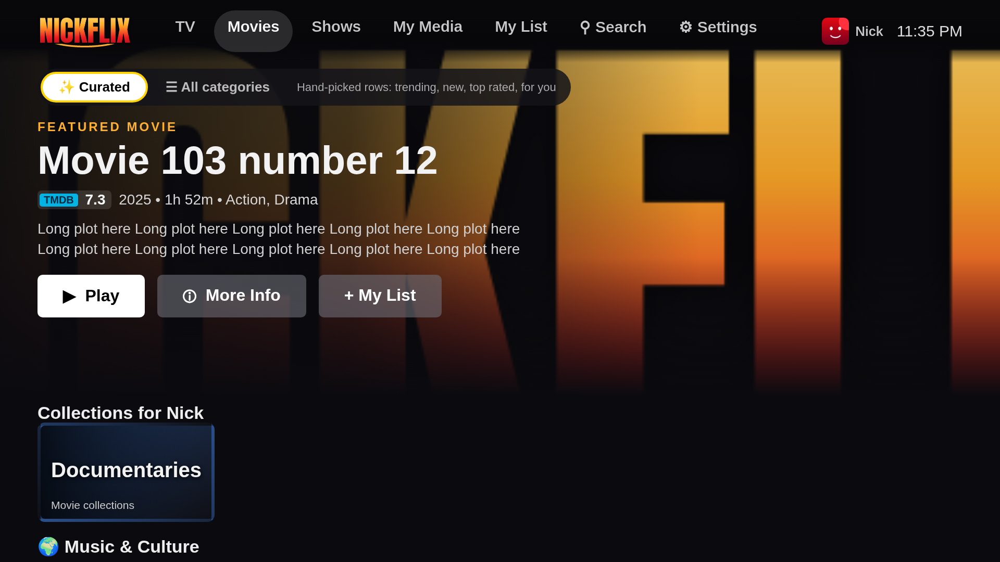
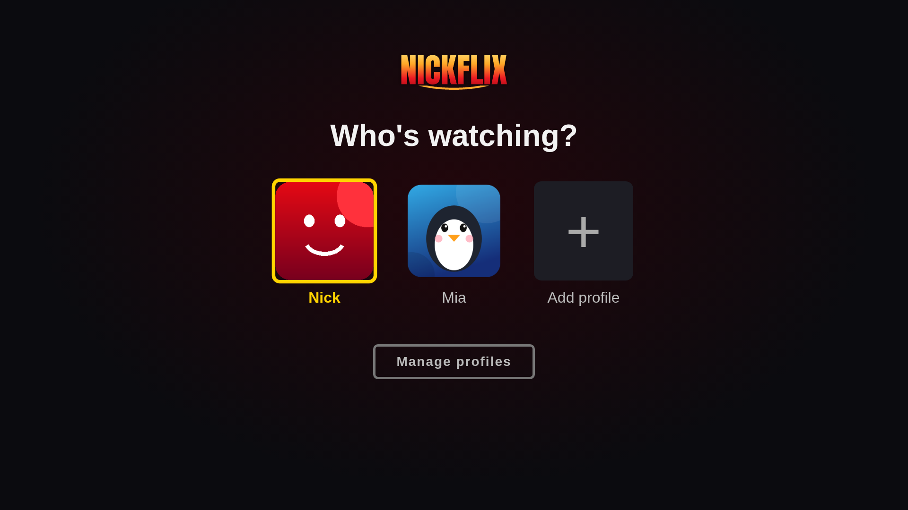
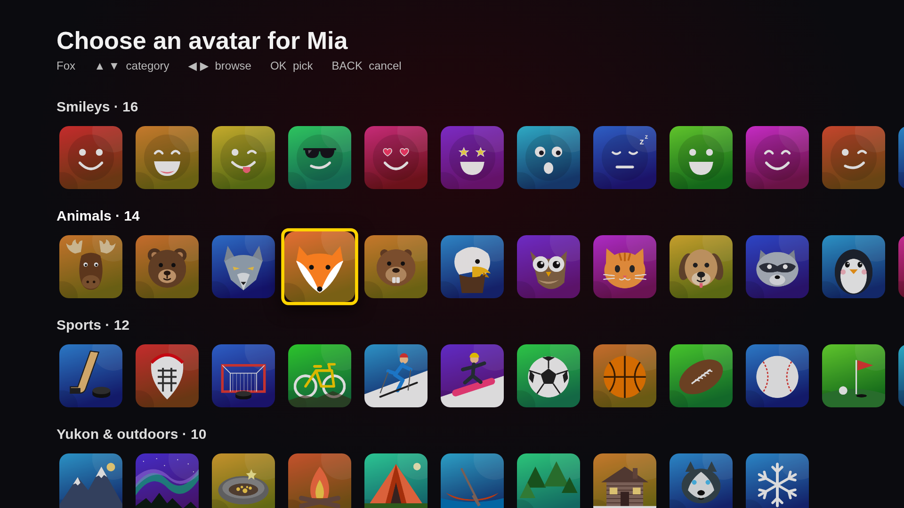
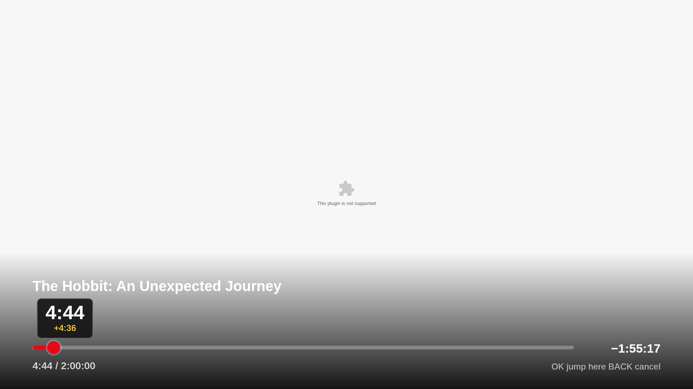
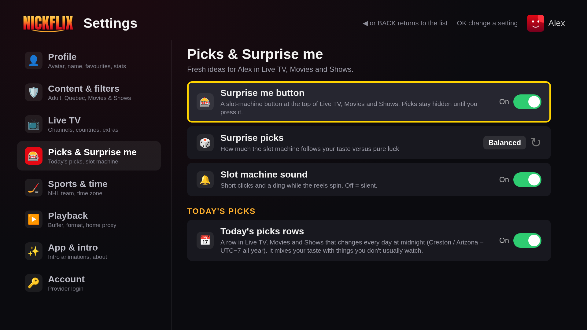

# NickFlix

A Netflix-style IPTV app for Samsung Tizen TVs. It sits on top of an Xtream-codes compatible IPTV
account (live TV, movies, series) and a home NAS (Twonky/DLNA), and adds what the stock players lack:
profiles, curated rows, sports with live NHL data, a per-profile learning hub, a NAS "My Media" library,
resilient playback and Netflix-style scrubbing. Plain ES5 JavaScript, no framework, no build step
beyond copying files.

> NickFlix does not include or point to any content. You need your own IPTV subscription and/or NAS.



| Profiles | Avatar picker | Scrubbing |
|---|---|---|
|  |  |  |



## Features (by version)
See [CHANGELOG.md](CHANGELOG.md) for details.

- **v1** Netflix-style TV / Movies / Shows tabs, language, genre and source filters.
- **v2** Profiles, Curated/All, My List, Continue Watching, stats page, Live TV filters, TMDB ratings.
- **v3** TV hub with picture tiles, Sports (NHL API + ESPN), team picker, News now/next, Live Events banner, per-profile learning.
- **v4** Country sub-category and network tiles, per-profile Adult toggle (off by default), Quebec filter, channel logos, extra foreign channels.
- **v4.1–4.2** Country pages show only their own channels; original intro animation with generated sound.
- **v4.3** Per-profile watch history, "Because you watched", "Top picks", taste-based ordering.
- **v4.4** Favourite categories per profile, sub-categories, MTB row under NHL.
- **v4.5** Curated documentary and British collections; Sports "Live now" and "Coming up".
- **v4.6** My Media: NAS library with posters, genres, series grouping, auto-update, Cinemeta matching on the TV.
- **v4.7** Buffering/reconnect overhaul, playback diagnostics, Netflix-style scrubbing, 127 avatars, secrets moved to `config.js`.
- **v4.8** Cinematic intro: an extruded 3D logo slams in with a two-hit generated "ta-dum", then a flash, shockwave and light sweep, then a dive through a tunnel of light ribbons (`tools/render_intro.py` renders a preview MP4).
- **v4.9** Mini intro before shows (toggle), Motorsports section + Live rally racing row, Live Events ranked by significance with many more sources (ESPN + TheSportsDB).
- **v4.10** Stability for a distant/droppy provider: Extra-stable default buffer (~15–20 s behind live), pause-and-refill, automatic quality/format step-down, format learning; optional home buffering proxy for a NAS (`proxy/`).
- **v4.11** Settings redesign (category list + detail pane), 235 avatars in 20 groups with a categorized picker, a daily "Today's picks" row per section, and a 🎰 Surprise me slot machine (optional).
- **v4.12–4.13** Profile backup (TV file + NAS) with auto-restore; audio language selection.
- **v4.14** Taste seed for the Nick profile, cast/director affinity, 👎 / 👍 / 👍👍 ratings (details page + player), rotating themed rows and a daily mix, News (Canada / US / World) on the TV hub.
- **v4.15** 🚫 Never show, no NAS titles on Movies / Shows, daily prestige collections, taste seed v2.
- **v4.16** Quality floor, dedupe and junk clean-up, Curated / Categories / 🌐 Everything modes, category trim, Indian-content and Kids-content filters, per-profile vibe rows, implicit signals and diversity in the algorithm.

## Architecture
`app/` is the Tizen web app (load order is the `<script>` order in `index.html`):

| File | Role |
|---|---|
| `js/config.js` | **Your** provider login + NAS address (not in git; copy `config.example.js`) |
| `js/core.js` | localStorage helpers, account, Xtream API (`player_api.php`), category loading |
| `js/intro.js` | Intro animation + generated sound |
| `js/mini.js` | Mini intro before shows |
| `js/motor.js` | Motorsports rows, rally row, significance-ranked Live Events |
| `js/logos_idx.js`, `js/logos.js` | Channel-logo index and logo plates |
| `js/learn.js`, `js/wh.js` | Per-profile learning and watch history |
| `js/profiles.js`, `js/avatars.js` | Profiles; avatar catalogue (generated) |
| `js/ui.js` | DOM helpers, cards, toasts |
| `js/curated.js` | Curated rows (trending, new, top rated, for you) |
| `js/live.js`, `js/tvx.js`, `js/tvc.js` | TV hub, country pages, EPG, channel picker |
| `js/fav.js`, `js/coll.js` | Favourite categories and curated collections |
| `js/app.js` | Views, rows, focus/navigation, details page, base player |
| `js/sportslive.js` | Live now / Coming up sports rows (NHL + ESPN) |
| `js/nas_seed.js`, `js/nas.js` | My Media (Twonky JSON feed, title cleaning, Cinemeta matching) |
| `js/screens.js` | Settings, profile picker/editor, avatar picker, keys, boot |
| `js/player.js` | Playback layer (4.7 + 4.10): buffer profiles, pause-and-refill, step-down, reconnect, watchdog, format learning, home-proxy routing, diagnostics, Settings › Playback |
| `proxy/` | `nfproxy.py` home buffering proxy for a NAS (Docker / Container Station or native), see `proxy/README.md` |
| `js/scrub.js` | 4.7 Netflix-style scrubbing and media-key registration |
| `js/picks.js` | 4.11 Today's picks rows and the Surprise me slot machine |
| `js/taste.js` | 4.14 taste seed (Nick), people (cast/director) affinity, ratings store, `tasteBoost` / daily `tsMix` |
| `js/rate.js` | 4.14 rating buttons on the details page and the player Rate panel (▼ / GREEN) |
| `js/themes.js` | 4.14 rotating themed rows, Because you loved, More with <person>, daily row shuffle |
| `js/quality.js` | 4.16 quality floor, dedupe, Indian / kids filters, Everything mode, category trim, vibe rows, implicit signals + diversity |
| `js/news.js` | 4.14 News tiles + Live news now on the TV hub, Canada / US / World news pages |

Tools: `tools/build.py` (package), `tools/deploy.ps1` (sign + install with Tizen CLI), `tools/mock.py`
(local IPTV/NAS mock), `tools/mkav.py` / `tools/mkav2.py` / `tools/mkav3.py` (avatars), `tools/mkart.py` (logo/icon).
Tests (`tests/`) are Playwright scripts that drive the app in desktop Chrome against the mock, with a fake
`webapis.avplay` where needed (`tests/tpb.py` = playback/reconnect/scrub, `tests/tav.py` = avatar picker).

## Configure
```bash
mkdir -p private
cp app/js/config.example.js private/config.js   # fill in server, username, password, nasBase
# optional: private/nas_seed.js (pre-matched NAS titles)
```
`private/` and `app/js/config.js` are gitignored. Never commit real credentials.

## Build
```bash
python3 tools/build.py            # -> dist/app/ and dist/nickflix.zip (config.js + <access> origins injected)
```

## Sign and deploy (Windows, Tizen Studio CLI)
1. Install Tizen Studio + the TV extensions, create a **Samsung** certificate profile in Certificate
   Manager (author + distributor certificates; keep the `.p12` files and passwords out of this repo).
2. Put the TV in Developer Mode (Apps → type 12345 → enter your PC's IP), then `sdb connect <tv-ip>`.
3. Package, install and launch:
```powershell
$env:NF_CERT_PROFILE = "my-samsung-profile"   # name of your certificate profile
$env:NF_TV_TARGET    = "QN65XXXXXX"           # as listed by `sdb devices`
powershell -ExecutionPolicy Bypass -File tools\deploy.ps1 -Zip dist\nickflix.zip
```
Reinstalling over the same app id keeps profiles (localStorage). Uninstalling wipes them.

## Test locally
```bash
pip install playwright && python -m playwright install chromium   # or set CHROME=/path/to/chrome
python3 tools/build.py --config tests/config.test.js --out dist
python3 tools/mock.py &          # serves dist/app on http://127.0.0.1:8099 with a fake provider + NAS
python3 tests/tpb.py             # playback / reconnect / scrubbing (fake AVPlay)
python3 tests/tav.py             # avatar picker
tests/run_all.sh /tmp/nf_runall  # everything (builds, starts the mock + nfproxy, runs all tests incl. t414)
```

## Notes
- AVPlay can only be exercised on a real TV; the tests use a scripted fake.
- Many IPTV accounts allow a single connection: don't test streams from a PC while the TV is playing.
- Avatar art, logo and intro are original; the font Anton is SIL OFL (see `tools/fonts`).
